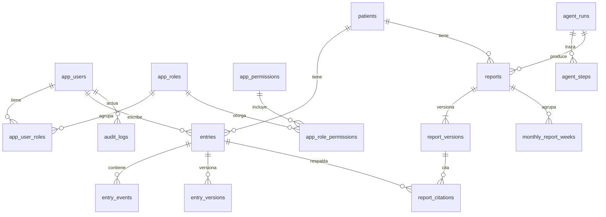

# DICCIONARIO DE DATOS — Patient Progress Auditor

> **Estado:** borrador v0.1 para aprobación · **Fase del ciclo de vida:** 3 — Diseño (modelo de datos) · **Fecha:** 2026-10-28
> **Base:** `docs/SPEC.md` v0.7 (§4 permisos y arranque en frío, §7 decisiones), `docs/REQUISITOS.md` v0.4 (RF-01 a RF-42, RN-01 a RN-11, modelo conceptual §6) y las migraciones existentes `V1__create_rbac.sql` y `V2__seed_rbac.sql`.
>
> **Qué es:** el detalle físico de lo que el modelo conceptual de `REQUISITOS.md` §6 dejó para el diseño: tablas, columnas, tipos, claves, valores permitidos y reglas de integridad. Es la base de las migraciones Flyway y de las entidades del backend; no las sustituye.
>
> **Para el Momento 2:** `docs/DICCIONARIO_DATOS_M2.md` es el recorte a lo que se construye en ese momento, sin lo del Momento 3 y con los 13 puntos de §8 cerrados por una propuesta marcada. Es el que se usa para escribir `V3` y `V4`; si algo que está en los dos cambia, se actualizan los dos.
>
> **Origen:** cada columna cita el requisito (RF, RN, RNF) o la decisión (D) que la pide. Lo que el diccionario agrega para poder construir y no viene de un requisito se marca **[Propuesta]** y queda por confirmar en §8.
>
> **Hito:** **M2-N** núcleo del Momento 2 · **M2-S** Momento 2 si hay tiempo · **M3** Momento 3 · **Opc** opcional, igual que en `REQUISITOS.md`.

---

## 1. Convenciones

| Tema | Convención | Origen |
|---|---|---|
| Idioma de los identificadores | Tablas y columnas en inglés y `snake_case`, como las tablas `app_*` existentes y el paquete `com.patientprogressauditor`. Cada columna lleva su etiqueta en español en este diccionario. La interfaz y los documentos siguen en español | [Equipo], resuelve el pendiente de `AGENTS.md` |
| Idioma de los valores | Los códigos de dominio ya fijados en los documentos se conservan en español y en mayúsculas: `ENFERMERIA`, `MEDICO`, `PENDIENTE_REVISION`, `APROBADO`, `VOZ` | RF-23, RF-32, RF-38 |
| Nombres de tabla | Plural. Las del RBAC llevan el prefijo `app_` (ya existen); las del dominio no | V1 |
| Clave primaria | `UUID` generado por la aplicación y sin valor por defecto, como en V1. Los datos sembrados usan UUID fijos para que la semilla sea idempotente (`ON CONFLICT DO NOTHING`, como V2). Excepción: `agent_steps` y `audit_logs` usan `BIGINT` autoincremental porque su orden es la fuente de eventos | V1, V2, RF-05, D24 |
| Fechas y horas | `DATE` para días del dominio (fecha de la entrada, límites del período) y `TIMESTAMPTZ` para instantes (`created_at`). Semana de lunes a domingo; mes de cuatro semanas. La zona horaria para decidir el día de una entrada es **[Propuesta]** `America/Bogota` | RN-06, RN-10 |
| Auditoría de fila | Toda tabla con filas editables lleva `created_at` y `updated_at` (`TIMESTAMPTZ`, por defecto `CURRENT_TIMESTAMP`), como V1. Las tablas que solo se agregan llevan `created_at` | V1 |
| Borrado | Ninguna fila de dominio se borra: no hay `ON DELETE CASCADE` en las claves foráneas del dominio y las entradas e informes solo se corrigen con versión. Los usuarios, roles y permisos se desactivan con `active` | RNF-10, RF-33 |
| Texto de la entrada | `entries.body` guarda lo que la persona escribió y nunca se actualiza; el texto corregido va en `entry_versions`. Las citas de los informes apuntan al original | RN-05, RN-07, RF-42 |
| Cifras | No se guardan métricas calculadas: el código las calcula cada vez a partir de entradas y eventos. El informe guarda una copia de las cifras que usó | RN-04, RF-07, RF-13 |
| Datos personales | Solo datos sintéticos. Al proveedor del LLM salen únicamente el `id` interno del paciente y el texto (ver §6) | RNF-02, RF-01 |
| Nulos y valores por defecto | Una columna es `NOT NULL` salvo que este diccionario diga lo contrario | — |

## 2. Mapa de entidades

| Tabla | Etiqueta | Qué guarda | Hito | Requisitos |
|---|---|---|---|---|
| `app_users` | Usuarios | Quién actúa: usuarios de demostración desde el Momento 2, cuentas con credenciales desde el Momento 3. Existe; requiere cambios (§7) | M2-N · M3 | RF-31, RF-32, RF-33, RF-39 |
| `app_roles` | Roles | `ENFERMERIA`, `MEDICO`, `ADMIN` y el rol técnico `AGENTE`. Existe; solo tiene `ADMIN` | M2-N | RF-32 |
| `app_permissions` | Permisos | Qué se puede hacer por módulo y acción. Existe; faltan los del dominio | M2-N | RF-32, RF-34 |
| `app_user_roles` | Usuario–rol | Rol de cada usuario. Existe | M2-N | RF-32 |
| `app_role_permissions` | Rol–permiso | Permisos de cada rol. Existe | M2-N | RF-32, RF-34 |
| `patients` | Pacientes | Persona seguida, con id interno y alias legible | M2-N | RF-01 |
| `entries` | Entradas | Registro diario en texto libre, tal como se escribió | M2-N | RF-02, RF-04, RN-07, RN-09 |
| `entry_events` | Eventos de la entrada | Síntomas con intensidad y veces, propuestos por la IA y confirmados por una persona | M2-N | RF-06, RF-40, RF-41, RN-11 |
| `entry_versions` | Versiones de la entrada | Texto corregido o editado, con quién y cuándo | M2-S | RF-03, RF-42 |
| `reports` | Informes | Informe semanal o mensual de un paciente, con su estado y su revisión | M2-N | RF-08, RF-23, RF-26, RF-27, RF-36 |
| `report_versions` | Versiones del informe | Contenido del modelo y cada edición de enfermería | M2-N | RF-11, RF-18, RF-25 |
| `report_citations` | Citas del informe | Qué entradas respalda cada afirmación | M2-N | RF-12, RN-05 |
| `monthly_report_weeks` | Semanas del informe mensual | Las cuatro semanas aprobadas que componen un mensual | M2-N | RF-36, RN-10 |
| `agent_runs` | Ejecuciones | Estado, límites, proveedor y costo de cada ejecución del agente o de cada estructuración | M2-N | RF-16, RF-17, RF-19, RF-22, D24 |
| `agent_steps` | Pasos de la ejecución | La traza: cada llamada, herramienta, validación y fallo, en orden | M2-N | RF-22, RNF-07, D24 |
| `audit_logs` | Auditoría | Quién hizo una acción sensible, cuándo, y el antes y el después | M2-S | RF-35, D12 |

## 3. Catálogos (valores permitidos)

Se guardan como `VARCHAR` con `CHECK`, no como `ENUM` de PostgreSQL, para poder cambiarlos con una migración corriente.

### 3.1 Roles

| Código | Qué es | Hito | Origen |
|---|---|---|---|
| `ENFERMERIA` | Registra, genera, revisa, corrige y aprueba o rechaza | M2-N | RF-32, RN-02 |
| `MEDICO` | Consulta informes `APROBADO` y registra entradas | M2-N | RF-28, RF-30, D12 |
| `ADMIN` | Gestiona usuarios y roles; no lee datos clínicos | M3 | RF-33, RF-34 |
| `AGENTE` | Rol técnico del agente: lectura y guardar el borrador; sin usuario ni contraseña | M2-N | RF-09, RF-32 |

### 3.2 Estados y tipos

| Campo | Valores | Notas | Origen |
|---|---|---|---|
| `reports.status` | `PENDIENTE_REVISION`, `INCOMPLETO`, `APROBADO`, `RECHAZADO` | Valor inicial `PENDIENTE_REVISION`, o `INCOMPLETO` si se agotó un límite. Transiciones en §5 | RF-17, RF-23 |
| `reports.report_type` | `SEMANAL`, `MENSUAL` | | RF-08, RF-36 |
| `report_versions.origin` | `MODELO`, `ENFERMERIA` | La versión 1 es siempre `MODELO` | RF-25 |
| `entries.source` | `TEXTO`, `VOZ` | `VOZ` solo si entra el dictado | RF-38 |
| `entries.structuring_status` | `ESTRUCTURADA`, `SIN_ESTRUCTURAR` | Ver la definición en §5 y el punto 7 de §8 | RF-41 |
| `entry_events.event_type` | `SINTOMA` | Otros tipos (ánimo, alimentación) dependen del catálogo de métricas | RF-06, D18 |
| `entry_events.intensity` | `LEVE`, `MODERADO`, `INTENSO`, `SIN_INDICAR` | La pantalla del equipo muestra «intenso» y «Sin indicar»; los otros dos son **[Propuesta]** | RF-06, D27 |
| `entry_events.origin` | `IA`, `EDITADO`, `MANUAL` | Propuesto por la IA y confirmado igual, propuesto y cambiado por la persona, o agregado a mano | RF-40, D27 |
| `entry_versions.origin` | `IA_ACEPTADA`, `IA_EDITADA`, `MANUAL` | Texto corregido propuesto por la IA y aceptado o editado, o edición manual | RF-03, RF-42 |
| `agent_runs.run_type` | `INFORME`, `ESTRUCTURACION` | **[Propuesta]**: la estructuración al registrar también deja traza | RF-22, RNF-07 |
| `agent_runs.status` | `EN_COLA`, `EN_CURSO`, `COMPLETADA`, `INCOMPLETA`, `FALLIDA` | **[Propuesta]**: el estado de la ejecución vive en la BD para poder consultarlo y reanudar | D24 |
| `agent_runs.stop_reason` | `EXITO`, `MAX_ITERACIONES`, `MAX_TOKENS`, `TIMEOUT_HERRAMIENTA`, `SALIDA_INVALIDA`, `PROVEEDOR_NO_DISPONIBLE` | **[Propuesta]**: el motivo con el que termina | RF-16, RF-17, RF-19 |
| `agent_steps.step_type` | `ESTADO`, `LLAMADA_LLM`, `HERRAMIENTA`, `VALIDACION`, `LIMITE`, `FALLBACK`, `ERROR` | **[Propuesta]** | RF-22, D24 |
| `audit_logs.action` | `APROBAR_INFORME`, `RECHAZAR_INFORME`, `EDITAR_INFORME`, `EDITAR_ENTRADA`, `REGISTRAR_ENTRADA_MEDICO`, `CAMBIAR_PERMISOS` | `CAMBIAR_PERMISOS` es del Momento 3 | RF-35 |

### 3.3 Catálogo de permisos del dominio

V2 dejó los permisos del dominio «hasta que la especificación cierre sus nombres canónicos». Estos son los nombres propuestos, derivados de la matriz de `SPEC.md` §4. Los permisos `USERS_*`, `ROLES_*` y `PERMISSIONS_READ` ya existen en V2.

| Código | Qué permite | ENFERMERIA | MEDICO | ADMIN | AGENTE | Hito | Origen |
|---|---|---|---|---|---|---|---|
| `PATIENTS_READ` | Ver pacientes | Sí | Sí | — | Sí | M2-N | SPEC §4 |
| `PATIENTS_CREATE` | Crear pacientes | Sí | — | — | — | M2-N | RF-01 |
| `PATIENTS_UPDATE` | Actualizar pacientes | Sí | — | — | — | M2-N | SPEC §4 |
| `ENTRIES_READ` | Ver entradas y eventos | Sí | Sí | — | Sí | M2-N | SPEC §4 |
| `ENTRIES_CREATE` | Registrar entradas y confirmar sus eventos | Sí | Sí | — | — | M2-N | RF-02, RF-40, D12 |
| `ENTRIES_UPDATE` | Corregir una entrada con versión | Sí | — | — | — | M2-S | RF-03 |
| `REPORTS_READ` | Ver informes; para el médico solo `APROBADO`, regla de estado en la consulta | Sí | Sí | — | — | M2-N | RN-01, RF-28 |
| `REPORTS_REQUEST` | Pedir la generación de un informe | Sí | — | — | — | M2-N | RF-08, **[Propuesta]** |
| `REPORTS_CREATE_DRAFT` | Guardar el borrador en `PENDIENTE_REVISION` | — | — | — | Sí | M2-N | RF-09, SPEC §4 |
| `REPORTS_UPDATE` | Editar el borrador antes de aprobar | Sí | — | — | — | M2-N | RF-25 |
| `REPORTS_APPROVE` | Aprobar o rechazar un informe; fijo para enfermería | Sí | — | — | — | M2-N | RN-02, RF-26, RF-27, RF-34 |
| `TRACES_READ` | Ver el módulo de trazas | — | — | Sí | — | M3 | SPEC §4; ver punto 1 de §8 |
| `USERS_CREATE`, `USERS_READ`, `USERS_UPDATE`, `USERS_DELETE` | Administrar usuarios | — | — | Sí | — | M3 | V2, RF-33 |
| `ROLES_READ`, `ROLES_UPDATE` | Ver y editar roles y permisos | — | — | Sí | — | M3 | V2, RF-34 |
| `ROLES_CREATE`, `ROLES_DELETE` | Existen en V2; la matriz da a administración solo ver y actualizar | — | — | Sí (V2) | — | M3 | Ver punto 2 de §8 |
| `PERMISSIONS_READ` | Ver el catálogo de permisos | — | — | Sí | — | M3 | V2 |

## 4. Tablas

Columnas: **Clave** indica `PK`, `FK → tabla` o `UQ` (único). **Nulo** dice si la columna admite `NULL`. Las columnas marcadas «nueva» o «cambia» no están en V1.

### 4.1 `app_users` — Usuarios (M2-N usuarios · M3 credenciales)

Quién actúa. En el Momento 2 son los usuarios de demostración sembrados, sin credenciales, entre los que se elige (D26); en el Momento 3 son cuentas con inicio de sesión (D23).

| Columna | Etiqueta | Tipo | Nulo | Clave | Descripción y reglas | Origen |
|---|---|---|---|---|---|---|
| `id` | Id | `UUID` | No | PK | Generado por la aplicación. UUID fijo en los usuarios de demostración | V1, RF-05 |
| `email` | Correo | `VARCHAR(320)` | No | UQ | Los usuarios de demostración llevan correos ficticios de un dominio reservado (por ejemplo `enfermera.demo@example.test`). Desde el Momento 3 es el usuario de inicio de sesión | V1, RF-31, RF-39 |
| `display_name` | Nombre visible | `VARCHAR(100)` | No | — | Nueva. Nombre ficticio que se muestra al elegir usuario y como autor en entradas, informes y auditoría | RF-39, D26, **[Propuesta]** |
| `password_hash` | Hash de la contraseña | `VARCHAR(100)` | Sí | — | Cambia: en V1 es `NOT NULL`. Los usuarios de demostración del Momento 2 no tienen credenciales, así que debe admitir `NULL`; desde el Momento 3 es obligatorio para quien inicia sesión. Se cifra con el `PasswordEncoder` de la aplicación: nunca hay un hash en una migración | D23 |
| `is_demo` | Usuario de demostración | `BOOLEAN` | No | — | Nueva. `TRUE` en los sembrados con `APP_SEED_DEMO=true`; lista los que se pueden elegir y permite excluirlos en `prod`. Por defecto `FALSE` | RF-39, D26, **[Propuesta]** |
| `active` | Activo | `BOOLEAN` | No | — | Por defecto `TRUE`. Se desactiva, no se borra | V1, RF-33 |
| `created_at` | Creado | `TIMESTAMPTZ` | No | — | Por defecto `CURRENT_TIMESTAMP` | V1 |
| `updated_at` | Actualizado | `TIMESTAMPTZ` | No | — | Por defecto `CURRENT_TIMESTAMP` | V1 |

### 4.2 `app_roles`, `app_permissions`, `app_user_roles`, `app_role_permissions` — RBAC (M2-N)

Existen en V1 y no cambian de estructura; lo que cambia es su contenido (§3.1 y §3.3).

| Tabla | Columnas | Reglas |
|---|---|---|
| `app_roles` | `id UUID PK` · `code VARCHAR(50) UQ` · `active BOOLEAN` · `created_at` · `updated_at` | V2 solo siembra `ADMIN`; faltan `ENFERMERIA`, `MEDICO` y `AGENTE` (§3.1) |
| `app_permissions` | `id UUID PK` · `code VARCHAR(100) UQ` · `active BOOLEAN` · `created_at` · `updated_at` | Faltan los permisos del dominio (§3.3) |
| `app_user_roles` | `user_id UUID FK → app_users` · `role_id UUID FK → app_roles` · `PK (user_id, role_id)` | Un usuario de demostración tiene un rol. Las tablas de unión del RBAC conservan su `ON DELETE CASCADE` de V1; es la única excepción a la regla de no borrar |
| `app_role_permissions` | `role_id UUID FK → app_roles` · `permission_id UUID FK → app_permissions` · `PK (role_id, permission_id)` | El permiso `REPORTS_APPROVE` solo se asigna a `ENFERMERIA` y el tablero de permisos no permite cambiarlo (RF-34, Momento 3) |

El rol `AGENTE` no tiene fila en `app_users`: es técnico y no inicia sesión (SPEC §4, arranque en frío).

### 4.3 `patients` — Pacientes (M2-N)

| Columna | Etiqueta | Tipo | Nulo | Clave | Descripción y reglas | Origen |
|---|---|---|---|---|---|---|
| `id` | Id interno | `UUID` | No | PK | Único identificador del paciente que sale al proveedor del LLM | RF-01, RNF-02 |
| `alias` | Alias | `VARCHAR(100)` | No | — | Nombre sintético o iniciales para mostrar. Nunca se envía al LLM ni a la traza. No es único | RF-01 |
| `created_at` | Creado | `TIMESTAMPTZ` | No | — | | V1 |
| `updated_at` | Actualizado | `TIMESTAMPTZ` | No | — | | V1 |

### 4.4 `entries` — Entradas diarias (M2-N)

Una fila por registro. Se permiten varias entradas el mismo día (RN-09).

| Columna | Etiqueta | Tipo | Nulo | Clave | Descripción y reglas | Origen |
|---|---|---|---|---|---|---|
| `id` | Id | `UUID` | No | PK | | RF-02 |
| `patient_id` | Paciente | `UUID` | No | FK → `patients` | | RF-02 |
| `entry_date` | Fecha de la entrada | `DATE` | No | — | Día que describe el texto; puede ser anterior al día en que se registró. Define a qué semana pertenece (lunes a domingo) | RF-02, RN-06 |
| `body` | Texto original | `TEXT` | No | — | Lo que la persona escribió, sin cambios. Ninguna operación lo actualiza ni lo borra; es la fuente que citan los informes. El texto no es instrucción para el agente | RF-02, RN-05, RN-07, RF-21 |
| `author_id` | Autor | `UUID` | No | FK → `app_users` | Usuario de demostración elegido (Momento 2) o autenticado (Momento 3). Puede ser enfermería o médico | RF-02, RF-30, D12 |
| `source` | Origen del texto | `VARCHAR(10)` | No | — | `TEXTO` por defecto o `VOZ`; sin audio guardado | RF-38, RNF-02 |
| `structuring_status` | Estado de estructuración | `VARCHAR(20)` | No | — | `ESTRUCTURADA` si una persona confirmó la propuesta de eventos, aunque sea vacía; `SIN_ESTRUCTURAR` si se guardó sin confirmarla (falló la IA o se guardó solo el texto). El informe declara las entradas sin estructurar | RF-40, RF-41, RN-08 |
| `created_at` | Registrada | `TIMESTAMPTZ` | No | — | Instante en que se guardó; ordena las entradas dentro del día. No hay `updated_at`: la fila no cambia | RN-09 |

**Índice:** `(patient_id, entry_date, created_at)` para listar por fecha y filtrar por rango (RF-04).

### 4.5 `entry_events` — Eventos de la entrada (M2-N)

Un síntoma (u otro evento) que el texto dice, propuesto por el LLM y confirmado por una persona. Solo existen eventos confirmados: lo que se descarta no se guarda (RN-11).

| Columna | Etiqueta | Tipo | Nulo | Clave | Descripción y reglas | Origen |
|---|---|---|---|---|---|---|
| `id` | Id | `UUID` | No | PK | | RF-06 |
| `entry_id` | Entrada | `UUID` | No | FK → `entries` | Enlaza al texto original | RF-06 |
| `event_type` | Tipo | `VARCHAR(30)` | No | — | `SINTOMA` en el Momento 2 (§3.2) | RF-06, D18 |
| `description` | Descripción normalizada | `VARCHAR(100)` | No | — | Nombre estable del evento («Dolor de cabeza», «Diarrea», «Apetito bajo»); es la clave con la que el código cuenta los días con cada síntoma. Si es lista cerrada o texto libre está por decidir | RF-06, RF-07, D18 |
| `event_date` | Fecha del evento | `DATE` | No | — | Por defecto la fecha de la entrada. Si el texto dice otro día («vomitó el lunes») la fecha del evento puede ser distinta; está por confirmar | RF-06, **[Propuesta]** |
| `intensity` | Intensidad | `VARCHAR(15)` | No | — | `SIN_INDICAR` por defecto; el modelo no la infiere si el texto no la dice | RF-06, RN-11, D27 |
| `occurrences` | Veces | `SMALLINT` | Sí | — | Entero mayor que 0 si el texto lo dice («dos veces» pasa a 2); vacío si no | RF-06, RN-11 |
| `origin` | Origen del evento | `VARCHAR(10)` | No | — | `IA`, `EDITADO` o `MANUAL` (§3.2) | RF-40 |
| `confirmed_by` | Confirmó | `UUID` | No | FK → `app_users` | Quién dejó el evento; no se guarda un evento sin confirmación | RF-40, RN-11 |
| `confirmed_at` | Confirmado | `TIMESTAMPTZ` | No | — | | RF-40 |
| `created_at` | Creado | `TIMESTAMPTZ` | No | — | | V1 |

**Restricciones:** `CHECK (occurrences IS NULL OR occurrences > 0)`. **Índices:** `(entry_id)` y `(event_type, description, event_date)` para las métricas semanales (RF-07).

### 4.6 `entry_versions` — Versiones de la entrada (M2-S)

El texto corregido por la IA (ortografía y puntuación, sin cambiar el contenido) o editado por una persona. La versión vigente es la de mayor `version_no`; si no hay ninguna, vale el original.

| Columna | Etiqueta | Tipo | Nulo | Clave | Descripción y reglas | Origen |
|---|---|---|---|---|---|---|
| `id` | Id | `UUID` | No | PK | | RF-03 |
| `entry_id` | Entrada | `UUID` | No | FK → `entries` | | RF-03 |
| `version_no` | Número de versión | `INTEGER` | No | — | Desde 1; el original es la versión 0 implícita y no se repite aquí. `UNIQUE (entry_id, version_no)` | RF-03 |
| `body` | Texto de la versión | `TEXT` | No | — | | RF-03, RF-42 |
| `origin` | Origen de la versión | `VARCHAR(15)` | No | — | `IA_ACEPTADA`, `IA_EDITADA` o `MANUAL` | RF-42 |
| `created_by` | Quién | `UUID` | No | FK → `app_users` | Quién confirmó o cambió el texto | RF-03, RF-42 |
| `created_at` | Cuándo | `TIMESTAMPTZ` | No | — | | RF-03 |

### 4.7 `reports` — Informes (M2-N)

Un informe de un paciente y un período. Lo que el modelo redactó y lo que enfermería editó vive en `report_versions`; esta tabla guarda el estado y quién lo revisó.

| Columna | Etiqueta | Tipo | Nulo | Clave | Descripción y reglas | Origen |
|---|---|---|---|---|---|---|
| `id` | Id | `UUID` | No | PK | | RF-08 |
| `patient_id` | Paciente | `UUID` | No | FK → `patients` | | RF-08 |
| `report_type` | Tipo | `VARCHAR(10)` | No | — | `SEMANAL` o `MENSUAL` | RF-08, RF-36 |
| `period_start` | Inicio del período | `DATE` | No | — | Siempre un lunes: `CHECK (EXTRACT(ISODOW FROM period_start) = 1)`. En el mensual, el lunes de la primera de las cuatro semanas | RN-06, RN-10 |
| `period_end` | Fin del período | `DATE` | No | — | Siempre un domingo: `period_start + 6` en el semanal y `period_start + 27` en el mensual | RN-06, RN-10 |
| `status` | Estado | `VARCHAR(20)` | No | — | Por defecto `PENDIENTE_REVISION`. Valores y transiciones en §3.2 y §5 | RF-17, RF-23 |
| `status_reason` | Motivo | `TEXT` | Sí | — | Obligatorio en `INCOMPLETO` (qué límite se agotó) y en `RECHAZADO` (motivo que escribe enfermería) | RF-17, RF-27 |
| `requested_by` | Pidió | `UUID` | No | FK → `app_users` | Quién solicitó la generación | RF-08 |
| `run_id` | Ejecución | `UUID` | Sí | FK → `agent_runs` | La ejecución que lo produjo. Vacío en los informes del conjunto sintético, que se siembran ya aprobados o, en uno de ellos, pendiente de revisión | RF-22, RF-05 |
| `provider` | Proveedor | `VARCHAR(50)` | Sí | — | Proveedor que respondió; alimenta la nota de asistencia de IA del PDF | RF-19, RF-37 |
| `model` | Modelo | `VARCHAR(100)` | Sí | — | Modelo que redactó el borrador | RF-37, D15 |
| `reviewed_by` | Revisó | `UUID` | Sí | FK → `app_users` | Quién aprobó o rechazó. Debe tener el rol `ENFERMERIA`: lo valida el servidor, no la BD | RN-02, RF-26 |
| `reviewed_at` | Revisado | `TIMESTAMPTZ` | Sí | — | Cuándo se aprobó o rechazó | RF-26 |
| `approved_version_no` | Versión aprobada | `INTEGER` | Sí | — | Qué versión de `report_versions` se aprobó; es la que ve el médico | RF-25, RF-28 |
| `created_at` | Creado | `TIMESTAMPTZ` | No | — | | V1 |
| `updated_at` | Actualizado | `TIMESTAMPTZ` | No | — | | V1 |

**Restricciones:**
- `CHECK ((status IN ('APROBADO','RECHAZADO')) = (reviewed_by IS NOT NULL AND reviewed_at IS NOT NULL))`.
- `CHECK (status <> 'APROBADO' OR approved_version_no IS NOT NULL)`.
- `CHECK (status NOT IN ('INCOMPLETO','RECHAZADO') OR status_reason IS NOT NULL)`.
- Índice único parcial `(patient_id, report_type, period_start) WHERE status IN ('PENDIENTE_REVISION','APROBADO')`: a lo sumo un informe vigente por paciente y período; uno `RECHAZADO` o `INCOMPLETO` no bloquea pedir uno nuevo **[Propuesta]**.
- Índices: `(patient_id, period_start DESC)` para la consulta del médico y `(status)`.

### 4.8 `report_versions` — Versiones del informe (M2-N)

La versión 1 es la que escribió el modelo y no se toca; cada edición de enfermería agrega una versión. Así se conserva el original del modelo y las ediciones.

| Columna | Etiqueta | Tipo | Nulo | Clave | Descripción y reglas | Origen |
|---|---|---|---|---|---|---|
| `id` | Id | `UUID` | No | PK | | RF-25 |
| `report_id` | Informe | `UUID` | No | FK → `reports` | | RF-25 |
| `version_no` | Número de versión | `INTEGER` | No | — | Desde 1. `UNIQUE (report_id, version_no)` | RF-25 |
| `origin` | Origen | `VARCHAR(12)` | No | — | `MODELO` (versión 1) o `ENFERMERIA` | RF-25 |
| `content` | Contenido | `JSONB` | Sí | — | El informe con estructura fija validada por esquema (ver la estructura abajo). Vacío solo si se degradó a texto plano | RF-11, RF-18 |
| `plain_text` | Texto plano | `TEXT` | Sí | — | Respaldo cuando la salida no valida tras un reintento: se degrada a texto plano y se registra. `CHECK (content IS NOT NULL OR plain_text IS NOT NULL)` | RF-18 |
| `edited_by` | Editó | `UUID` | Sí | FK → `app_users` | Obligatorio si `origin = 'ENFERMERIA'`; vacío en la versión del modelo | RF-25, RF-35 |
| `created_at` | Creado | `TIMESTAMPTZ` | No | — | | RF-25 |

**Estructura de `content`** (JSON con claves en inglés, validado por esquema en el servidor):

| Clave | Qué contiene | Origen |
|---|---|---|
| `summary` | Resumen en lenguaje claro | RF-11, RNF-09 |
| `metrics` | Las cifras de la semana o del mes, copiadas del módulo de métricas: el validador rechaza el informe si una cifra no coincide | RF-07, RF-13, RN-04 |
| `changes_vs_previous` | Cambios frente a la semana anterior; en el mensual, la evolución semana a semana | RF-11, RF-36 |
| `recurring_patterns` | Síntomas que reaparecen o persisten | RF-11, OBJ-02 |
| `insufficient_data` | Semanas, días o entradas sin información suficiente, declarados sin rellenar; incluye las entradas `SIN_ESTRUCTURAR` | RF-14, RF-41, RN-08 |
| `claims` | Lista de afirmaciones: `claim_key`, `text`, `criterion` (criterio de comparación) y `entry_ids` (al menos una entrada citada) | RF-12, RN-05 |

### 4.9 `report_citations` — Citas del informe (M2-N)

Índice normalizado de `content.claims`: una fila por afirmación y entrada citada. Da integridad referencial a las citas y permite abrir la evidencia «a un clic».

| Columna | Etiqueta | Tipo | Nulo | Clave | Descripción y reglas | Origen |
|---|---|---|---|---|---|---|
| `report_version_id` | Versión del informe | `UUID` | No | PK, FK → `report_versions` | | RF-12 |
| `claim_key` | Afirmación | `VARCHAR(40)` | No | PK | Clave de la afirmación dentro de `content.claims` | RF-12 |
| `entry_id` | Entrada citada | `UUID` | No | PK, FK → `entries` | Siempre el texto original de la entrada, no una versión | RF-12, RN-05, RF-42 |

La clave primaria es `(report_version_id, claim_key, entry_id)`. Cada `claim_key` del contenido debe tener al menos una fila: lo comprueba el validador antes de guardar el borrador (RN-05).

### 4.10 `monthly_report_weeks` — Semanas del informe mensual (M2-N)

Deja a la vista de qué cuatro informes semanales sale un mensual.

| Columna | Etiqueta | Tipo | Nulo | Clave | Descripción y reglas | Origen |
|---|---|---|---|---|---|---|
| `monthly_report_id` | Informe mensual | `UUID` | No | PK, FK → `reports` | Un informe con `report_type = 'MENSUAL'` | RF-36 |
| `week_no` | Semana | `SMALLINT` | No | PK | De 1 a 4: `CHECK (week_no BETWEEN 1 AND 4)` | RN-10 |
| `weekly_report_id` | Informe semanal | `UUID` | No | FK → `reports` | Un informe `SEMANAL` en estado `APROBADO`, de las cuatro semanas consecutivas. `UNIQUE (monthly_report_id, weekly_report_id)` | RN-10 |

Que los cuatro semanales estén `APROBADO` y sean consecutivos lo valida el servidor antes de generar el mensual; la BD no lo puede expresar (§5).

### 4.11 `agent_runs` — Ejecuciones (M2-N)

Una fila por ejecución del agente de informes y por cada estructuración de una entrada. El estado vive aquí para poder consultarlo si se corta la conexión de progreso.

| Columna | Etiqueta | Tipo | Nulo | Clave | Descripción y reglas | Origen |
|---|---|---|---|---|---|---|
| `id` | Id | `UUID` | No | PK | | D24 |
| `run_type` | Tipo de ejecución | `VARCHAR(20)` | No | — | `INFORME` o `ESTRUCTURACION` | RF-22, **[Propuesta]** |
| `patient_id` | Paciente | `UUID` | No | FK → `patients` | | RF-22 |
| `requested_by` | Pidió | `UUID` | No | FK → `app_users` | | RF-08 |
| `period_start` | Inicio solicitado | `DATE` | Sí | — | Solo en `INFORME` | RF-08 |
| `period_end` | Fin solicitado | `DATE` | Sí | — | Solo en `INFORME` | RF-08 |
| `status` | Estado | `VARCHAR(15)` | No | — | `EN_COLA` por defecto; valores en §3.2 | D24 |
| `stop_reason` | Motivo de parada | `VARCHAR(30)` | Sí | — | Vacío mientras corre; al terminar, `EXITO` o el límite o fallo que la detuvo | RF-16, RF-17 |
| `provider` | Proveedor | `VARCHAR(50)` | Sí | — | El que respondió; cambia si se usó el de respaldo | RF-19, RF-20 |
| `model` | Modelo | `VARCHAR(100)` | Sí | — | | D15 |
| `fallback_used` | Usó respaldo | `BOOLEAN` | No | — | Por defecto `FALSE` | RF-19 |
| `iterations` | Iteraciones | `INTEGER` | No | — | Por defecto 0; se compara con el tope de iteraciones | RF-16 |
| `tokens_in` | Tokens de entrada | `INTEGER` | No | — | Por defecto 0; suma de la ejecución, contra el presupuesto de tokens | RF-16, RNF-06 |
| `tokens_out` | Tokens de salida | `INTEGER` | No | — | Por defecto 0 | RF-16, RNF-06 |
| `cost_usd` | Costo estimado | `NUMERIC(10,6)` | Sí | — | Costo por tarea, para la línea base de cifras; 0 en la capa gratuita | RNF-06, OBJ-11 |
| `error_message` | Mensaje de error | `VARCHAR(500)` | Sí | — | Mensaje honesto para el usuario; nunca un stack trace | RF-19, RNF-04 |
| `started_at` | Inicio | `TIMESTAMPTZ` | Sí | — | | RF-22 |
| `finished_at` | Fin | `TIMESTAMPTZ` | Sí | — | La latencia se mide como mediana sobre `finished_at - started_at` | OBJ-11 |
| `created_at` | Creado | `TIMESTAMPTZ` | No | — | | V1 |

**Índices:** `(patient_id, created_at DESC)` y `(status)`. El número de ejecuciones simultáneas lo acota el ejecutor en proceso (D24), no la BD.

### 4.12 `agent_steps` — Pasos de la ejecución, la traza (M2-N)

Una fila por cosa que pasó: cada llamada al modelo, cada herramienta, cada validación, límite o fallo. Su orden es la fuente de eventos del progreso por SSE y el punto desde donde se reanuda (D24).

| Columna | Etiqueta | Tipo | Nulo | Clave | Descripción y reglas | Origen |
|---|---|---|---|---|---|---|
| `id` | Id | `BIGINT` | No | PK | Autoincremental y creciente: la conexión de progreso se reanuda desde el último `id` visto | D24 |
| `run_id` | Ejecución | `UUID` | No | FK → `agent_runs` | | RF-22 |
| `seq` | Orden | `INTEGER` | No | — | Posición dentro de la ejecución. `UNIQUE (run_id, seq)` | RF-22 |
| `step_type` | Tipo de paso | `VARCHAR(20)` | No | — | Valores en §3.2 | RF-22 |
| `tool_name` | Herramienta | `VARCHAR(60)` | Sí | — | Solo en `HERRAMIENTA`. Una de las herramientas autorizadas, pocas y de mínimo privilegio | RF-09, RF-22 |
| `message` | Mensaje de estado | `VARCHAR(300)` | Sí | — | Texto honesto que ve la persona («Consultando registros…»); sin stack trace | D24, RNF-05 |
| `params` | Parámetros | `JSONB` | Sí | — | Qué se pidió a la herramienta o al modelo | RF-22 |
| `result` | Resultado | `JSONB` | Sí | — | Qué devolvió. Datos sintéticos; no incluye el alias del paciente | RF-22, RNF-02 |
| `is_error` | Es un error | `BOOLEAN` | No | — | Por defecto `FALSE`. Un error de herramienta no mata el bucle: se devuelve al modelo como observación | RF-16, RNF-04 |
| `duration_ms` | Duración (ms) | `INTEGER` | Sí | — | | RF-22 |
| `tokens_in` | Tokens de entrada | `INTEGER` | Sí | — | | RF-22 |
| `tokens_out` | Tokens de salida | `INTEGER` | Sí | — | | RF-22 |
| `created_at` | Cuándo | `TIMESTAMPTZ` | No | — | | RF-22 |

### 4.13 `audit_logs` — Auditoría (M2-S)

Una fila por acción sensible. Solo se agregan filas; nunca se actualizan ni se borran.

| Columna | Etiqueta | Tipo | Nulo | Clave | Descripción y reglas | Origen |
|---|---|---|---|---|---|---|
| `id` | Id | `BIGINT` | No | PK | Autoincremental | RF-35 |
| `actor_id` | Quién | `UUID` | No | FK → `app_users` | Usuario de demostración elegido (Momento 2) o autenticado (Momento 3). Para un registro del médico identifica qué médico lo hizo | RF-35, D12, D26 |
| `actor_role` | Rol de quien actúa | `VARCHAR(20)` | No | — | Rol con el que actuó en ese momento | RF-35 |
| `action` | Acción | `VARCHAR(40)` | No | — | Valores en §3.2 | RF-35 |
| `entity_type` | Tipo de objeto | `VARCHAR(30)` | No | — | `ENTRY`, `REPORT` o `ROLE_PERMISSION` | RF-35 |
| `entity_id` | Objeto afectado | `UUID` | No | — | Id de la entrada, del informe o del rol; sin clave foránea porque apunta a varias tablas | RF-35 |
| `occurred_at` | Cuándo | `TIMESTAMPTZ` | No | — | Por defecto `CURRENT_TIMESTAMP` | RF-35 |
| `before_state` | Antes | `JSONB` | Sí | — | Estado previo; vacío si la acción crea el objeto | RF-35 |
| `after_state` | Después | `JSONB` | Sí | — | Estado resultante | RF-35 |

**Índices:** `(entity_type, entity_id)` y `(actor_id, occurred_at DESC)`.

## 5. Reglas de integridad

### 5.1 Qué garantiza la base de datos y qué el servidor

| Regla | Dónde se garantiza | Cómo | Origen |
|---|---|---|---|
| Solo enfermería aprueba o rechaza | Servidor y BD | El servidor comprueba el rol de `reviewed_by` y valida la transición; la BD exige `reviewed_by` y `reviewed_at` en `APROBADO` y `RECHAZADO` | RN-02, RF-26 |
| El médico solo ve informes `APROBADO` | Servidor | Es una regla de estado: va en la consulta (`status = 'APROBADO'` y la versión de `approved_version_no`), no en un permiso | RN-01, RF-28 |
| Una semana va de lunes a domingo; el mensual son 28 días | BD | `CHECK` sobre `period_start` y `period_end` en `reports` | RN-06, RN-10 |
| El mensual solo se genera con cuatro semanas consecutivas y aprobadas | Servidor y `monthly_report_weeks` | El servidor verifica las cuatro semanas antes de pedir el informe y, si falta una, no lo genera e indica cuál | RN-10, RF-36 |
| Toda afirmación cita al menos una entrada | Servidor | El validador exige una fila en `report_citations` por cada `claim_key` y que las entradas sean del mismo paciente | RN-05, RF-12 |
| Toda cifra del informe la calcula el código | Servidor | Se compara `content.metrics` con el módulo de métricas; si una cifra no coincide se rechaza y se reintenta | RN-04, RF-13 |
| El texto original no cambia | Servidor, y BD desde el Momento 3 | No hay operación de actualización de `entries`, que ni siquiera tiene `updated_at`. **[Propuesta]** Endurecer con permisos de BD (solo `INSERT` y `SELECT` sobre `entries`, `entry_versions`, `report_versions`, `agent_steps` y `audit_logs`) junto con el hardening del Momento 3 | RN-07, RNF-10, OBJ-14 |
| Ningún evento se guarda sin confirmación | BD y servidor | `confirmed_by` y `confirmed_at` son `NOT NULL`; la entrada y sus eventos confirmados se guardan en una sola transacción, y descartar no guarda nada | RN-11, RF-40 |
| Las entradas y los informes no se borran | BD | Ninguna clave foránea del dominio usa `ON DELETE CASCADE` y no hay operación de borrado | RNF-10 |
| Orden de las entradas del mismo día | BD | `created_at`, con el índice `(patient_id, entry_date, created_at)` | RN-09 |
| La semilla es idempotente y nunca corre en producción | Servidor | UUID fijos y `ON CONFLICT DO NOTHING`; solo con `APP_SEED_DEMO=true`; el perfil `prod` la rechaza | RF-05, RF-39, D23 |

### 5.2 Transiciones del estado del informe

| Desde | Hacia | Quién o qué | Hito | Origen |
|---|---|---|---|---|
| (generación) | `PENDIENTE_REVISION` | El agente termina con un informe válido y con fuente por afirmación | M2-N | RF-17, RF-23 |
| (generación) | `INCOMPLETO` | Se agotó un límite; el motivo queda en `status_reason` | M2-N | RF-17 |
| `PENDIENTE_REVISION` | `APROBADO` | Enfermería | M2-N | RN-02, RF-26 |
| `PENDIENTE_REVISION` | `RECHAZADO` | Enfermería, con motivo; después se pide un informe nuevo | M2-S | RF-27 |
| `INCOMPLETO` | por definir | No está decidido si puede aprobarse, rechazarse o solo regenerarse | — | Ver punto 8 de §8 |
| `APROBADO`, `RECHAZADO` | ninguna | Estados finales: un cambio se hace con un informe nuevo **[Propuesta]** | — | RF-23 |

## 6. Qué sale al proveedor del LLM y qué no se guarda

| Dato | ¿Sale al proveedor? | Nota | Origen |
|---|---|---|---|
| `patients.id` | Sí | Único identificador del paciente que se envía | RF-01, RNF-02 |
| `entries.body` y los eventos de las entradas | Sí | Texto sintético; al estructurar una entrada y como resultado de las herramientas del agente. Se trata como dato, no como instrucción | RNF-02, RF-21 |
| `patients.alias`, `app_users.display_name` y `email` | No | Nunca van al proveedor ni a la traza | RNF-02 |
| `app_users.password_hash` | No | | RNF-01 |
| Audio de dictado | No se guarda | Solo queda el texto transcrito, con `source = 'VOZ'` | RF-38, RNF-02 |
| Métricas calculadas | No se guardan | Se calculan al pedirlas; el informe guarda una copia de las que usó | RF-07 |
| PDF exportado | No se guarda | Se genera al vuelo desde un informe `APROBADO` | RF-37 |
| Propuesta descartada de eventos | Solo en la traza | Lo que no se confirma no es un evento; queda en `agent_steps.result` de la estructuración | RN-11, RF-22 |

Lo que sale a terceros se declara en `docs/gobernanza.md` (Momento 3).

## 7. Cambios necesarios en las migraciones

V1 y V2 existen y no se editan: se agregan migraciones nuevas. Roles y permisos van en migración; los usuarios de demostración y el conjunto sintético los crea el `ApplicationRunner` idempotente (D23, RF-05, RF-39).

| Migración | Qué hace | Hito |
|---|---|---|
| `V3__domain_schema.sql` | En `app_users`: agrega `display_name` e `is_demo` y permite `NULL` en `password_hash`. Crea `patients`, `entries`, `entry_events`, `entry_versions`, `reports`, `report_versions`, `report_citations`, `monthly_report_weeks`, `agent_runs`, `agent_steps` y `audit_logs`, con sus `CHECK`, claves e índices | M2-N (`entry_versions` y `audit_logs` M2-S) |
| `V4__seed_domain_rbac.sql` | Siembra los roles `ENFERMERIA`, `MEDICO` y `AGENTE` y los permisos del dominio de §3.3 con sus asignaciones, con UUID fijos y `ON CONFLICT DO NOTHING` como V2 | M2-N |
| `ApplicationRunner` de la semilla | Con `APP_SEED_DEMO=true` y nunca en `prod`: usuarios de demostración con su rol, 5 pacientes (D11), unas 120 entradas con sus eventos ya confirmados y 5 informes semanales: 4 `APROBADO` del paciente con cinco semanas, para mostrar el mensual, y 1 `PENDIENTE_REVISION`. No llama al LLM | M2-N |
| Credenciales y administrador | Desde el Momento 3: contraseña de los usuarios de demostración desde una variable de entorno, y el usuario `ADMIN` | M3 |

## 8. Puntos por resolver

Cada punto cambia una columna, un valor o un permiso de este diccionario; ninguno bloquea empezar con el resto. `docs/DICCIONARIO_DATOS_M2.md` §8 propone un cierre para cada uno en el Momento 2 (por ejemplo, el evento toma la fecha de su entrada y no tiene `event_date`).

1. **Trazas.** La matriz de `SPEC.md` §4 da el módulo Trazas solo a `ADMIN` (Momento 3), pero RF-24 y RF-29 muestran las llamadas de herramientas a enfermería y al médico, y CU-07 dice que enfermería ve la traza. Lectura propuesta: la traza de la ejecución de un informe es parte de su evidencia (`REPORTS_READ`) y el módulo global de trazas es de `ADMIN`. Confirmar o corregir la matriz.
2. **Permisos de roles.** V2 da a `ADMIN` los permisos `ROLES_CREATE` y `ROLES_DELETE`, y la matriz solo le da ver y actualizar roles y permisos. Quitarlos en `V4` o ampliar la matriz.
3. **`password_hash` en el Momento 2.** V1 lo exige. Propuesta: admitir `NULL` hasta el Momento 3; se descartó un hash de relleno porque sería una credencial falsa.
4. **Fecha del evento.** Si el texto dice «vomitó el lunes» y se escribió el miércoles, ¿el evento va al lunes o a la fecha de la entrada? Afecta los «días con cada síntoma» de RF-07.
5. **Descripción normalizada.** ¿Lista cerrada de síntomas (una tabla de catálogo, ligada a D18) o texto libre normalizado por el modelo? Con texto libre, «Diarrea» y «Deposiciones líquidas» contarían como síntomas distintos.
6. **Intensidad y veces.** Confirmar los valores de intensidad (D27) y si «veces» es por entrada o por día; RF-07 todavía no las usa en las métricas.
7. **Qué es «sin estructurar».** RF-41 dice «sin eventos confirmados». Este diccionario usa: `SIN_ESTRUCTURAR` si se guardó sin confirmar la propuesta, y `ESTRUCTURADA` si una persona la confirmó, incluso con cero eventos (un texto sin síntomas no es un fallo). Si se acepta, ajustar el texto de RF-41.
8. **Informe `INCOMPLETO`.** ¿Puede aprobarse, rechazarse o solo regenerarse? Falta en RF-23 y en §5.2.
9. **Paciente dado de alta.** La SPEC lo lista como caso borde sin comportamiento esperado; por eso `patients` no tiene fecha de alta ni estado.
10. **Zona horaria.** El día de una entrada y los límites de la semana dependen de ella; se propone `America/Bogota`.
11. **Informe nuevo tras un rechazo.** RF-27 dice «pedir uno nuevo»; el diccionario no liga el informe nuevo con el rechazado. Si se quiere esa traza, agregar `replaces_report_id` en `reports`.
12. **Quién pide la generación.** La matriz no da «crear» a enfermería en Informes, pero RF-08 dice que se genera a solicitud suya; se agrega `REPORTS_REQUEST` **[Propuesta]**.
13. **Editar los eventos de una entrada ya guardada.** No está definido; en esta versión los eventos no se actualizan tras la confirmación.

## 9. Trazabilidad requisito → tablas

| Requisito | Tablas y columnas |
|---|---|
| RF-01 | `patients` |
| RF-02, RF-04 | `entries` |
| RF-03, RF-42 | `entry_versions`, `entries.body` (original) |
| RF-05, RF-39 | `app_users.is_demo`, semilla de todas las tablas |
| RF-06, RF-40 | `entry_events` |
| RF-41 | `entries.structuring_status`, `agent_runs`, `agent_steps` |
| RF-07 | Ninguna propia: se calcula desde `entries` y `entry_events` |
| RF-08, RF-36 | `reports`, `monthly_report_weeks`, `agent_runs` |
| RF-09, RF-32 | `app_roles`, `app_permissions`, `app_user_roles`, `app_role_permissions` |
| RF-10, RF-16, RF-17, RF-19, RF-20, RF-22 | `agent_runs`, `agent_steps` |
| RF-11, RF-13, RF-14 | `report_versions.content` |
| RF-12, RF-24, RF-29 | `report_citations`, `report_versions.content.claims`, `agent_steps` |
| RF-15, RF-21 | Ninguna: son reglas del prompt, de la validación y de las herramientas disponibles |
| RF-18 | `report_versions.plain_text` |
| RF-23, RF-26, RF-27, RF-28 | `reports` (`status`, `status_reason`, `reviewed_by`, `reviewed_at`, `approved_version_no`) |
| RF-25 | `report_versions` |
| RF-30 | `entries.author_id` y el permiso `ENTRIES_CREATE` del médico |
| RF-31, RF-33 | `app_users` (`password_hash`, `active`) |
| RF-34 | `app_role_permissions`, `audit_logs` |
| RF-35 | `audit_logs` |
| RF-37 | `reports.provider` y `reports.model`; el PDF no se guarda |
| RF-38 | `entries.source` |
